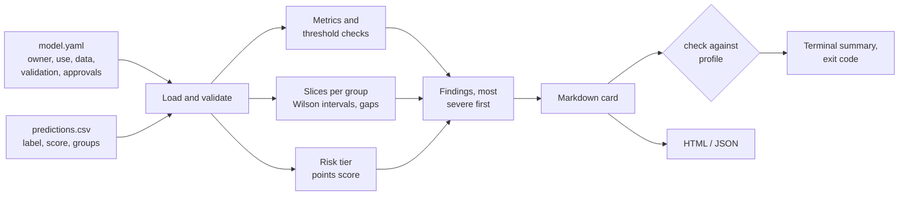

# model-card-generator

Build an audit-ready model card and model-risk summary from a YAML manifest and your predictions file, and fail CI when any card, generated or hand-written, is missing a section a reviewer needs.


▶ [Watch the 55-second demo video](https://github.com/sumankrsh/model-card-generator/releases/latest/download/demo.mp4)

## The problem

Model documentation is usually written by hand, once, for the approval meeting. Three things go wrong:

- **The numbers are typed in.** A card says "AUC 0.81" and nobody can tell which data it came from, or whether the file has changed since.
- **Group results are missing or unreadable.** A table of per-group rates without sample sizes doesn't tell a reviewer whether a gap is real or noise.
- **Gaps are found late.** Missing sections ("Limitations: TBD") turn up in the validation review, weeks after the model was built.

`model-card-generator` takes a short manifest (owner, intended use, data, lineage, validation, approvals) and the CSV of scored cases you already have. It computes every metric and every group comparison itself, records the SHA-256 of the file it read, suggests a model risk tier with the points shown, and lists findings for the owner and validator to answer. `model-card check` then works as a CI gate on any Markdown card, including ones your team already writes by hand.

## Quickstart

```bash
git clone https://github.com/sumankrsh/model-card-generator && cd model-card-generator
pip install .
model-card build examples/claims-fraud/model.yaml --markdown MODEL_CARD.md --html card.html
```

The example is a synthetic fraud-triage model for a made-up motor insurer, with 2,400 scored claims in `examples/claims-fraud/predictions.csv`. On a Linux cloud machine the command took about a quarter of a second, with no API key and no network. It prints:

| | Result |
|---|---|
| Metrics computed from the predictions | 10, including AUC 0.956, recall 0.717 and calibration error 0.113 |
| Thresholds from the manifest | 3 pass, 1 fails (calibration error above 0.10) |
| Group slices compared | 11 across age band, region and channel; 3 gaps flagged, 1 of them clear |
| Suggested risk tier | Tier 1 (11 of 13 points) |
| Findings | 2 high, 3 medium, 1 low |
| `model-risk` profile | 17 of 17 sections complete |

`MODEL_CARD.md` is the card; `card.html` is the same card as one page with no scripts and no external requests. The clear gap is real in the data: the 70+ age band has a true positive rate of 0.353 against 0.762 for the 30-49 reference, and their 95% intervals don't overlap.

To see the CI gate fail on a hand-written card:

```bash
model-card check examples/hand-written-card.md
```

It finds 7 of 17 required sections, names the missing ones with the guidance theme behind each, and flags `Limitations: TBD` at line 30. The exit code is 1.

## Features

- **Metrics you can trace.** From a CSV of labels and scores (or 0/1 predictions): AUC, accuracy, precision, recall, specificity, F1, false positive rate, selection rate, Brier score and expected calibration error. Thresholds in the manifest give a pass or fail for each. The card records the file's SHA-256 and the tool version.
- **Performance by group, with sample sizes.** For each group column, every slice is compared with a reference slice: selection rate ratio (flagged under 0.8, the four-fifths rule of thumb), true positive rate gap and false positive rate gap (flagged over 0.05). Each rate has a 95% Wilson interval, and a gap is called *clear* only when the intervals don't overlap. Small slices are marked.
- **A suggested risk tier with its working.** Decision impact, autonomy, complexity and whether the model affects individuals give a points score and a tier. Every point is in the card, so a reviewer can disagree with a specific input.
- **Findings for review.** Failed thresholds, group gaps, small slices, training data older than 18 months, a data file whose hash no longer matches, validation that isn't independent or is 12+ months old, an overdue review, open validation conditions, and missing owners, lineage, monitoring, oversight or approvals.
- **Three section profiles.** `core` (the sections of the original model card proposal), `model-risk` (adds themes from SR 11-7 and PRA SS1/23), and `eu-ai-act` (adds themes from Annex IV technical documentation). `model-card profiles` lists every section and where it comes from.
- **A check that reads hand-written cards.** Headings are matched by meaning ("Validation data" is evaluation data, "Caveats and recommendations" is limitations), sub-sections count, code blocks are skipped, and placeholders such as "TBD" or "Not provided" fail. `--github` adds error annotations for pull requests.
- **Outputs.** Terminal summary, Markdown, single-file HTML (light and dark), and JSON with every number, gap, finding and section status. `--strict` makes `build` exit 1 on any high finding or missing section.
- **A starting point.** `model-card init` writes a manifest with every field the card uses.

## How it works



1. The manifest is read with a safe YAML loader. If it names a predictions file, every row is read and checked: labels against `positive_label`, scores in 0-1, group columns present.
2. A row is a positive prediction when its score is at or above `threshold`, unless you give a `prediction_column`. AUC uses the rank-sum method with ties averaged; calibration error uses ten equal-width bins.
3. For each group column, the reference slice is the one you name in `reference_groups`, or the largest. Only the harmful direction is flagged: a lower true positive rate, a higher false positive rate, a lower selection rate.
4. The tier score is `2 × decision impact + autonomy + complexity + 1 if it affects individuals`, each factor scored 1 to 3. 10 or more is Tier 1, 7 to 9 Tier 2, lower Tier 3.
5. The Markdown card is written first, then checked with the same code `model-card check` uses, so the summary and the CI gate can't disagree.

Every number in this README came from running the commands above on the bundled synthetic examples. The predictions are drawn by `scripts/make_examples.py` from a seeded random generator, with weaker separation for the 70+ age band so there is a gap to find; rerunning it produces the same file.

## Configuration

### The manifest

Run `model-card init` for a commented starter, or read [examples/claims-fraud/model.yaml](examples/claims-fraud/model.yaml) for a complete one. The main blocks:

| Block | What goes in it |
|---|---|
| `model` | `name`, `version`, `owner`, `task`, `algorithm`, `description`, `date` |
| `intended_use` | `primary`, `users`, `out_of_scope` |
| `risk` | `decision_impact` (low, medium, high), `autonomy` (advisory, human-in-the-loop, automated), `complexity` (low, medium, high), `affects_individuals`, `regulatory_context` |
| `methodology` | `approach`, `features`, `assumptions`, `alternatives` |
| `data` | `training` and `evaluation`: `source`, `owner`, `period` (`YYYY-MM-DD to YYYY-MM-DD`), `rows`, and optionally `path` and `sha256` to pin a file |
| `lineage` | a list of `{step, from, to, owner}` |
| `evaluation` | `predictions`, `label_column`, `score_column` or `prediction_column`, `threshold`, `positive_label`, `groups`, `reference_groups`, `metric_thresholds` (e.g. `auc: {min: 0.8}`). Without a predictions file, `metrics` and `slices` are shown as reported. |
| `fairness` | `max_gap` (0.05), `min_ratio` (0.8), `min_slice_rows` (100) |
| `human_oversight`, `robustness`, `ethical_considerations`, `limitations` | lists of sentences |
| `monitoring` | `metrics`, `frequency`, `owner`, `triggers` |
| `validation` | `validator`, `independent`, `date`, `outcome`, `next_review`, `conditions` |
| `approvals`, `changes` | lists of `{role, name, date, decision}` and `{version, date, summary}` |

Anything left out appears in the card as "Not provided" and, where it matters, in the findings.

### Commands

| Command | Does |
|---|---|
| `model-card build MANIFEST` | Prints the summary. `--markdown`, `--html`, `--json` write files; `--profile` picks the profile (default `model-risk`); `--as-of YYYY-MM-DD` fixes the date used for staleness and overdue reviews; `--strict` exits 1 on high findings or missing sections. |
| `model-card check CARD.md [CARD.md ...]` | Exits 1 when a required section is missing, empty or a placeholder. `--profile`, `--github`. |
| `model-card profiles [NAME]` | Lists the profiles and their sections. |
| `model-card init [PATH]` | Writes a starter manifest. |

Exit status: 0 on success, 1 when a check or `--strict` fails, 2 for a bad file or option.

### In CI

```yaml
- run: pip install git+https://github.com/sumankrsh/model-card-generator
- run: model-card build models/fraud/model.yaml --markdown models/fraud/MODEL_CARD.md --strict
- run: model-card check docs/models/*.md --profile model-risk --github
```

## Limitations

- Binary classification only. Regression, ranking, multi-class and generative models aren't measured; you can still use `check` on their hand-written cards and give reported metrics in the manifest.
- The tier, the findings and the profiles are rule-based suggestions. They are not a validation opinion, and passing a profile doesn't mean a card complies with SR 11-7, PRA SS1/23 or the EU AI Act. The profiles paraphrase themes from those texts; read the originals for your own obligations.
- Group comparisons are one column at a time. Intersections (for example 70+ and aggregator) aren't compared, and no correction is made for testing many slices at once.
- `check` looks for headings and a few words under them. It can't tell whether the content is right, only that it is there.
- Reported metrics and slices (when there's no predictions file) are shown as given and not checked for gaps.
- All examples are synthetic: the insurer, teams, people, dates and rows are invented.

## More tools

Part of a small family of open-source tools for running AI with governance built in:

- **[ai-register](https://github.com/sumankrsh/ai-register)**: scans a codebase and keeps an AI inventory for EU AI Act and ISO/IEC 42001 reviews.
- **[mcp-gatekeeper](https://github.com/sumankrsh/mcp-gatekeeper)**: permissions, approvals and a tamper-evident audit log for MCP tool calls.
- **[enterprise-data-skills](https://github.com/sumankrsh/enterprise-data-skills)**: everyday data checks (SQL review, profiling, PII scans, model cards) for people and agents.
- **[agentbreak](https://github.com/sumankrsh/agentbreak)**: tests whether an attack makes an AI agent take an unauthorised action.
- **[prompt-ci](https://github.com/sumankrsh/prompt-ci)**: keeps prompts as owned, versioned and tested code, with a CI gate on changes.
- **[ai-policy-lint](https://github.com/sumankrsh/ai-policy-lint)**: checks agent configs, MCP configs and prompts against your company's AI policy.
- **[agent-crashlab](https://github.com/sumankrsh/agent-crashlab)**: injects tool failures into an agent and counts what it does twice.
- **[model-cost-pilot](https://github.com/sumankrsh/model-cost-pilot)**: routes each kind of request to the cheapest model that still passes your checks.
- **[contextlens](https://github.com/sumankrsh/contextlens)**: shows what each LLM call's context window held and where tokens were wasted.
- **[meeting-to-actions](https://github.com/sumankrsh/meeting-to-actions)**: turns meeting transcripts into owned, dated actions with the quote behind each one.
- **model-card-generator**: this tool, model cards and model-risk summaries computed from your predictions, with a CI check for missing sections.

See [github.com/sumankrsh](https://github.com/sumankrsh) for newer tools.

## Credits

No code was adapted from other projects. The `core` profile follows the sections proposed in "Model Cards for Model Reporting" (Mitchell et al., 2019). [TensorFlow Model Card Toolkit](https://github.com/tensorflow/model-card-toolkit) and the Hugging Face model card templates generate cards from structured fields; [Fairlearn](https://github.com/fairlearn/fairlearn) and [AIF360](https://github.com/Trusted-AI/AIF360) offer far more fairness metrics. This tool is smaller: no ML framework, every number computed from one CSV, and a section check aimed at model-risk review. The `model-doc` skill in [enterprise-data-skills](https://github.com/sumankrsh/enterprise-data-skills) drafts a card from metrics you have already computed; this tool computes them.

## Licence

MIT. See [LICENSE](LICENSE).
